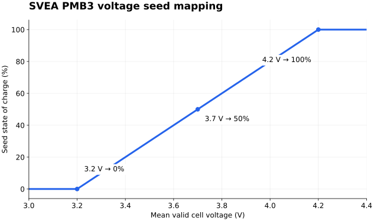

# Battery State of Charge

The PMB3 BQ769x2 driver calculates SOC in PX4 software and publishes it as
`battery_status.remaining` (a fraction from 0 to 1). With the board's default
`BAT1_CAPACITY=9000` mAh, it initializes SOC from cell voltage once, then
integrates signed battery current. The BQ chip supplies the measurements; this
path does not use the generic PX4 `Battery` library's SOC estimator.

## Voltage Mapping

`BQ769x2::estimateRemaining()` implements a **linear mapping**, with no lookup
table, polynomial, chemistry selection, or nonlinear discharge curve:

```text
SOC_voltage = clamp((V_avg - V_empty) / (V_charged - V_empty), 0, 1)
```

`V_avg` is the arithmetic mean of the selected cell readings greater than
0.5 V. It is not PACK voltage divided by `BAT1_N_CELLS`, nor the lowest cell
voltage. Channels come from `BQ769X2_VCMODE`; if that mask is zero, the driver
selects the first `BQ769X2_CELLS` channels. The PMB3 default mask is 515
(`0x0203`, channels VC1, VC2 and VC10).

| Parameter | PMB3 default | Role |
| --- | --- | --- |
| `BAT1_V_EMPTY` | 3.2 V/cell | Linear mapping's 0% endpoint |
| `BAT1_V_CHARGED` | 4.2 V/cell | Linear mapping's 100% endpoint; also used for full-charge reset |
| `BAT1_CAPACITY` | 9000 mAh | Capacity for current integration |
| `BQ769X2_VCMODE` | 515 | Selected measurement channels |
| `BQ769X2_CELLS` | 3 | Channel count when the selection mask is zero |

With these endpoints:



*Default firmware startup seed mapping. After seeding, SOC follows current
integration rather than this voltage curve.*

| Mean cell voltage | Balanced 3S cell sum | Voltage-based SOC |
| --- | --- | --- |
| 3.2 V | 9.6 V | 0% |
| 3.4 V | 10.2 V | 20% |
| 3.6 V | 10.8 V | 40% |
| 3.7 V | 11.1 V | 50% |
| 3.8 V | 11.4 V | 60% |
| 4.0 V | 12.0 V | 80% |
| 4.2 V | 12.6 V | 100% |

Values outside the endpoints are clipped. If
`V_charged <= V_empty + 0.01 V`, the voltage estimate is invalid (`-1`).
With no valid cell readings, the report's SOC stays unknown (`-1`).

## Startup and Current Integration

On the first valid voltage estimate with capacity `C > 0`, the driver seeds
its consumed-charge counter `D`:

```text
D = clamp((1 - SOC_voltage) * C, 0, C)       [mAh]
```

Every subsequent measurement integrates the latest signed CC2 current over
the elapsed time, nominally at 10 Hz:

```text
I = raw_CC2 * 0.01                         [A]
I = -I if BQ769X2_CURR_INV is enabled
I_effective = I if abs(I) > 0.05 A, otherwise 0
D = clamp(D + I_effective * 1000 * dt / 3600, 0, C)
SOC = clamp(1 - D / C, 0, 1)
```

Positive PX4 current means discharge, increasing `D` and lowering SOC.
Negative current means charging and raises SOC. This is a rectangular
integration using the current sample, not a trapezoidal average or the chip's
accumulated-charge register. Only intervals `0 < dt < 1 second` are integrated;
longer gaps are skipped. The first measurement has no preceding interval.

At startup, a mean cell voltage of 3.8 V therefore seeds 60% SOC and
`D=3600` mAh. Drawing 1 A for an hour adds 1000 mAh, leaving approximately
48.89% SOC. Voltage changes after seeding do not continuously correct that
estimate, except for the full-charge reset below.

If `BAT1_CAPACITY <= 0`, the driver instead reports the linear voltage estimate
on each measurement. This is an explicit branch in the implementation.

## Full-Charge Reset

With positive capacity and valid cells, SOC resets to 100% whenever both
conditions hold:

```text
V_avg >= BAT1_V_CHARGED - 0.02 V
abs(I) <= max(BQ769X2_BAL_IIDL, 0.2 A)
```

`BQ769X2_BAL_IIDL` defaults to 0.10 A, so the default reset condition is a mean
cell voltage of at least **4.18 V** and absolute current at most **0.2 A**.
This clears both consumed mAh and consumed Wh. There is no dwell time,
charger-presence check, or requirement that every individual cell reach 4.18 V.
The 0.02 V margin and 0.2 A minimum are hardcoded, not separate parameters.

## Interpretation and Limits

- The counters and seed flag live in driver RAM. A reboot or a stop/start that
  recreates the driver loses them and seeds SOC from voltage again. A temporary
  communication failure publishes a disconnected/failed report and does not
  itself reset the counters.
- `discharged_mah` includes the initial voltage-derived missing charge. It is
  not simply the measured consumption since boot. Consumed Wh starts at zero,
  so those two counters have different startup baselines.
- The voltage mapping has no load-sag, internal-resistance, temperature, or
  battery-age compensation. `BAT1_R_INTERNAL` and the generic PX4 battery
  filtering parameters do not alter this driver's SOC calculation. A startup
  voltage error persists until a full-charge reset or a new seed.
- Current accuracy and capacity accuracy directly affect SOC drift.
  `BQ769X2_SHUNT=1000` µΩ configures current gain as `7568.4 / shunt_uohm`
  when startup configuration is enabled. `BQ769X2_CURR_INV=1` is the board
  default; verify positive discharge current on the actual car.
- SOC uses mean cell voltage and does not represent the weakest cell.
  `BQ769X2_CUV_V` and `BQ769X2_COV_V` configure separate cell protection
  thresholds; they do not define the SOC curve. Battery warning thresholds
  `BAT_LOW_THR`, `BAT_CRIT_THR`, and `BAT_EMERGEN_THR` classify SOC; reported
  faults take precedence as `WARNING_FAILED`.
- Parameters update while running. Changing capacity after seeding changes
  the denominator without reseeding the consumed-charge counter.

These are firmware defaults, not evidence of the values saved on a particular
car or of the battery's measured discharge curve. Inspect the running system:

```sh
param show BAT1_*
param show BQ769X2_*
bq769x2 status
listener battery_status -n 5 -i 0
```

Confirm that the selected battery instance is the BQ report. For transport and
current-sign conventions, see [ROS Topics and Power Measurements](ros-topic-reference.md#battery-power-and-sign).

## Implementation Sources

Source inspected at revision `60d60053ad02d6ba38f66b97c7ce64653ff99105`:

- [BQ driver](https://github.com/nilskiefer/SVEA-PX4-Autopilot/blob/60d60053ad02d6ba38f66b97c7ce64653ff99105/src/drivers/smart_battery/bq769x2/bq769x2.cpp): `collectAndPublish()`, `estimateRemaining()`, `computeWarning()`, and `configure()`.
- [Driver state](https://github.com/nilskiefer/SVEA-PX4-Autopilot/blob/60d60053ad02d6ba38f66b97c7ce64653ff99105/src/drivers/smart_battery/bq769x2/bq769x2.h) and [BQ parameters](https://github.com/nilskiefer/SVEA-PX4-Autopilot/blob/60d60053ad02d6ba38f66b97c7ce64653ff99105/src/drivers/smart_battery/bq769x2/bq769x2_params.c).
- [PMB3 board defaults](https://github.com/nilskiefer/SVEA-PX4-Autopilot/blob/60d60053ad02d6ba38f66b97c7ce64653ff99105/boards/mikroe/clicker4-stm32f7/init/rc.board_defaults).
