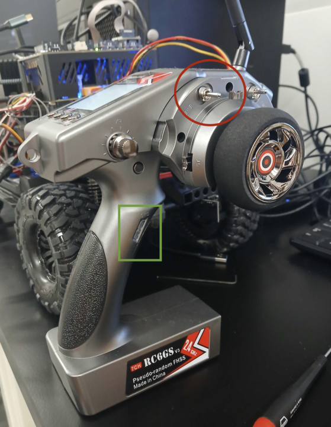

# Drive and arm the car {#controlling-the-car-rc-and-ros-mavlink}

Use SWD to arm or disarm the car. SWB selects who can drive. The RC receiver must be connected for transmitter button arming.

## Transmitter controls

| Control | Channel | Action |
| --- | --- | --- |
| SWD | CH7 | Arm or disarm with a momentary press |
| SWB | CH5 | Select ROS, RC-only, or kill |
| SWA | CH4 | Toggle gear with a momentary press |
| SWC | CH6 | Select the misc servo |
| VR | CH3 | Set the selected misc servo's position |

::: details Transmitter photo



SWB is in the middle, the RC-only position.

:::

## Select a control mode {#control-flow}

Turn on the transmitter and confirm the receiver link before arming. Set SWB to the mode you want.

| SWB position | PX4 mode | Who can drive |
| --- | --- | --- |
| Left (about 1000 µs) | `MODE_SLOT_1` | ROS/MAVLink, with RC taking over when commands go stale |
| Middle (about 1500 µs) | `MODE_SLOT_2` | RC only |
| Right (about 2000 µs) | `MODE_SLOT_3` | Kill switch asserted |

## Arm or disarm {#arming-and-disarming}

With SWB in the left or middle position, press SWD once to arm. Press it again to disarm. The Clicker4 defaults are `RC_MAP_ARM_SW=7` and `COM_ARM_SWISBTN=1`.

Check the armed state in the [PX4 console](quick-bringup.md#_4-open-nsh-over-mavlink-shell).

```sh
listener actuator_armed -n 1
```

## Gear and differential defaults {#diff-gear-default-in-rc-mode}

In RC mode, `RC_MAP_AUX1=17` and `RC_MAP_AUX2=17` use an unmapped channel to default the differentials to ON. Common receiver profiles put that channel near 1000 µs. The rear differential uses inverted polarity.

The `svea_rc_servo_latch` module starts in LOW gear (`+1`, high pulse on PCA9685 CH4). Each press of SWA toggles the gear through `RC_MAP_AUX4=4`.

## Misc servo selector {#rc-misc-servo-selector}

SWC selects the servo that follows the VR dial. The selected servo moves to the current dial position. The other output holds its last value.

| SWC position | Output |
| --- | --- |
| Low (about 1000 µs) | misc0, PCA9685 CH5 |
| Middle (about 1500 µs) | Both outputs hold |
| High (about 2000 µs) | misc1, PCA9685 CH6 |

The board uses `RC_MAP_AUX3=6` for SWC and `RC_MAP_AUX5=3` for VR.

## ROS manual control reference

`MANUAL_CONTROL` and `RC_CHANNELS_OVERRIDE` are accepted in `MODE_SLOT_1`. See [ROS manual control](ros-manual-control.md) for the message fields, rates, and test commands.
